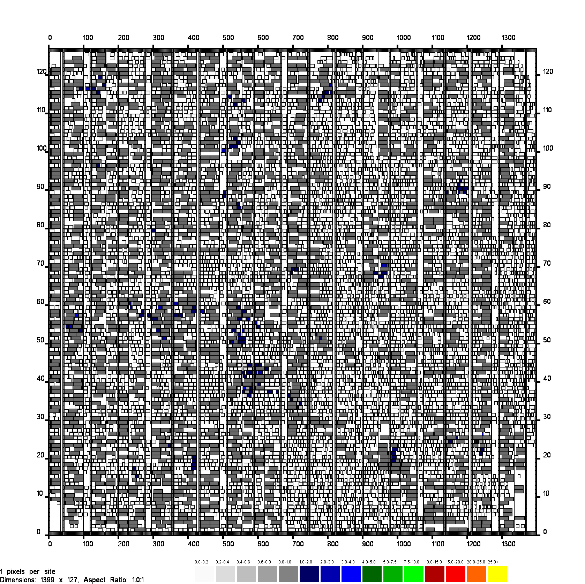
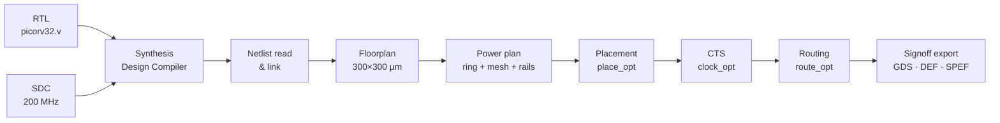

# PicoRV32 RISC-V Core: RTL-to-GDSII Implementation


I took the open-source **PicoRV32** RISC-V processor from Verilog RTL to a fully routed layout in the Synopsys SAED 32 nm educational technology. The flow covers synthesis, floorplanning, power planning, placement, clock tree synthesis, routing and signoff export, all scripted in TCL.

At 200 MHz the routed design **meets setup timing with +3.37 ns of slack**, at **70.3% utilization**, with **0 open nets and 0 routing DRCs**.

> Individual project, completed in June 2026.

---

## Contents

- [Results](#results)
- [Design flow](#design-flow)
- [Repository structure](#repository-structure)
- [How to run](#how-to-run)
- [Design decisions and lessons learned](#design-decisions-and-lessons-learned)
- [Known issues and next steps](#known-issues-and-next-steps)
- [Credits and license](#credits-and-license)

---

## Results

### Post-route (IC Compiler II, scenario `func::nom`, 200 MHz)

| Metric | Value |
|---|---|
| Setup WNS / TNS | **+3.37 ns** / 0.00 ns (0 violating paths) |
| Hold WNS / TNS | −0.00 ns / −0.01 ns (6 marginal paths) |
| Die size | 300 µm × 300 µm |
| Cell area (logic) | 42,507 µm² |
| Cell area (incl. physical-only cells) | 48,317 µm² |
| Core utilization | 70.3% |
| Total nets | 12,946 |
| Open nets / routing DRCs | **0 / 0** |
| Global-route congestion | 4.17% of GRCs with overflow |

### Clock tree (after CTS)

| Metric | Value |
|---|---|
| Clock sinks (flip-flops) | 1,576 |
| Tree levels | 5 |
| Clock repeaters | 38 |
| Max clock latency | 0.11 ns |
| Global skew | **0.02 ns** |

### Synthesis (Design Compiler, SAED32 RVT, ss 0.7 V −40 °C)

| Metric | Value |
|---|---|
| Leaf cells | 9,254 (7,610 combinational, 1,644 sequential) |
| Cell area | 29,224 µm² |
| Design area (incl. wire-load estimate) | 40,302 µm² |
| Estimated total power | 845 µW (97% in the ideal clock network) |
| Worst setup slack | −0.18 ns at the slow corner, closed during placement optimization |

Full reports are in [`results/`](results/), one folder per stage.

### Placement legalization map

This plot comes from ICC2's legalizer. Each block is a standard cell, and its colour shows how far legalization moved it: most moved less than 2 sites.

<p align="center">
  
</p>

---

## Design flow



| # | Stage | Script | What it does |
|---|---|---|---|
| 0 | Synthesis | [`dc_synth.tcl`](scripts/synthesis/dc_synth.tcl) | Maps the RTL to SAED32 RVT cells with `compile_ultra` and writes the netlist and SDC |
| 1 | Setup | [`01_setup.tcl`](scripts/pnr/01_setup.tcl) | Paths and variables shared by every PnR script |
| 2 | Netlist read | [`02_netlist_read.tcl`](scripts/pnr/02_netlist_read.tcl) | Creates the NDM library, reads and links the netlist, applies constraints |
| 3 | Floorplan | [`03_floorplan.tcl`](scripts/pnr/03_floorplan.tcl) | 300 × 300 µm die at 65% target utilization; pins on all four sides |
| 4 | Power planning | [`04_power_planning.tcl`](scripts/pnr/04_power_planning.tcl) | VDD/VSS core ring (M7/M8), power mesh (M6–M8) and M1 standard-cell rails |
| 5 | Placement | [`05_placement.tcl`](scripts/pnr/05_placement.tcl) | Sets Cmax/Cmin parasitics, then runs timing-driven `place_opt` and legalization |
| 6 | CTS | [`06_clock.tcl`](scripts/pnr/06_clock.tcl) | Builds the clock tree with local-skew optimization and concurrent clock/data (CCD) |
| 7 | Routing | [`07_route.tcl`](scripts/pnr/07_route.tcl) | Global, track and detail routing with antenna diodes, then `route_opt` |
| 8 | Signoff export | [`08_signoff_outputs.tcl`](scripts/pnr/08_signoff_outputs.tcl) | Final reports, then writes GDSII, DEF, SPEF, netlist and SDC |

A step-by-step explanation of each stage is in [`docs/FLOW.md`](docs/FLOW.md).

---

## Repository structure

```
picorv32-rtl-to-gdsii/
├── rtl/
│   └── picorv32.v              # PicoRV32 RTL (third-party, ISC license)
├── constraints/
│   └── picorv32.sdc            # 200 MHz timing constraints
├── scripts/
│   ├── synthesis/
│   │   └── dc_synth.tcl        # Design Compiler synthesis
│   └── pnr/
│       ├── 01_setup.tcl … 08_signoff_outputs.tcl
│       └── run_pnr.tcl         # runs stages 02–08 in order
├── results/
│   ├── synthesis/
│   │   ├── reports/            # area, power, QoR, timing, constraints
│   │   └── netlist/            # mapped netlist + SDC
│   └── pnr/
│       ├── 01_floorplan/  02_powerplan/  03_placement/
│       ├── 04_cts/        05_route/      # reports per stage
│       └── netlist/            # routed netlist + SDC
└── docs/
    ├── FLOW.md                 # stage-by-stage walkthrough
    └── images/
```

---

## How to run

**Requirements:** Synopsys Design Compiler and IC Compiler II (tested with W-2024.09), plus the SAED32 EDK. The SAED32 libraries are licensed by Synopsys and are **not** included here.

1. Put the SAED32 files under `ref/` in the repository root:

   ```
   ref/lib/stdcell_rvt/saed32rvt_ss0p7vn40c.db
   ref/lib/ndm/saed32rvt_c.ndm
   ref/tech/milkyway/saed32nm_1p9m_mw.tf
   ref/tech/star_rcxt/saed32nm_1p9m_Cmax.tluplus
   ref/tech/star_rcxt/saed32nm_1p9m_Cmin.tluplus
   ref/tech/star_rcxt/saed32nm_tf_itf_tluplus.map
   ```

2. Run synthesis, then place and route, from a `work/` directory:

   ```bash
   mkdir -p work && cd work
   dc_shell   -f ../scripts/synthesis/dc_synth.tcl | tee synthesis.log
   icc2_shell -f ../scripts/pnr/run_pnr.tcl         | tee icc2.log
   ```

   You can also run the stages one at a time from `icc2_shell`, for example `source ../scripts/pnr/05_placement.tcl`.

3. Reports appear in `work/reports/` and output files in `work/outputs/`.

---

## Design decisions and lessons learned

- **Fixing over-utilization.** My first floorplan failed placement: ICC2 reported **106.6% utilization**, with 43,200 µm² of cells for 40,530 µm² of placeable area. I re-sized the die to 300 × 300 µm at a 65% target. That gave the optimizer room for buffering and hold fixing, and the design settled at 70.3% after routing.
- **Synthesis corner versus implementation corner.** Synthesis used the slow-slow library (0.7 V, −40 °C) with wire-load models and ended 0.18 ns short. After placement, real parasitics and the nominal corner gave +3.37 ns of setup slack.
- **The clock dominates power.** 97% of estimated power sits in the clock network, which is typical for a register-heavy core: PicoRV32 has 1,644 flip-flops, mostly in its 32 × 32 register file. Clock gating would be the first power optimization to try.
- **A low-skew clock tree.** Turning on local-skew optimization and CCD in `clock_opt` gave a 5-level tree with 0.02 ns global skew across 1,576 sinks.
- **A layered power grid.** The core ring is on M7/M8, the interleaved mesh on M6–M8, and the standard-cell rails on M1. The power-grid DRC check reported no errors and no missing vias.

---

## Known issues and next steps

- [ ] Fix the 6 marginal hold paths (−0.01 ns total) with a hold-fixing ECO before signoff.
- [ ] Run multi-corner multi-mode (MCMM) analysis with ss, tt and ff scenarios. Only `func::nom` was used here.
- [ ] Run signoff STA in PrimeTime on the extracted SPEF.
- [ ] Run physical verification (DRC/LVS) on the final GDSII.
- [ ] Add functional simulation of the RTL and gate-level netlist with a RISC-V test program.

---

## Credits and license

- **PicoRV32 RTL** (`rtl/picorv32.v`) is by Claire Xenia Wolf ([YosysHQ/picorv32](https://github.com/YosysHQ/picorv32)), under the ISC license. The original copyright notice is kept in the file.
- **Scripts, constraints, reports and documentation** are my own work, released under the [MIT License](LICENSE).
- **SAED32 EDK** is © Synopsys, Inc. and is not distributed here.

**Author:** Mokshit Lattha, B.Tech. Electronics & Communication Engineering, Pandit Deendayal Energy University  
📧 latthamoksh2006@gmail.com
